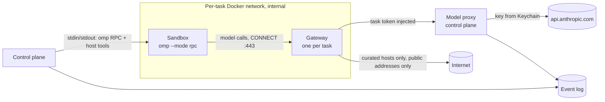

# 0002: The containment runtime

- **Status:** accepted when merged.
- **Level:** policy. These mechanisms are how [lane-0001](../../lanes/0001-containment.md) moves four laws from `advisory` to `runtime` or `ci`:
  - [L-0005](../../laws/L-0005-halt.md) (halt);
  - [L-0006](../../laws/L-0006-reserved-actions.md) (reserved actions);
  - [L-0024](../../laws/L-0024-sandbox-and-privilege.md) (sandbox);
  - [L-0027](../../laws/L-0027-budgets.md) (budgets).

  Every file that implements them is protected core. Nothing described here exists yet.

## Context

Until those four laws are enforced, [L-0037](../../laws/L-0037-bootstrap-supervision.md) keeps every merge under approval. The laws fix most of the design:

- **Isolation (L-0024).** Each task gets its own sandbox:
  - its filesystem is the workspace;
  - its network is an allowlist set by its task kind;
  - it holds no host credentials;
  - its credentials are scoped to the task and expire with it.
- **Secrets (L-0025).** A sandbox never holds a provider key, and no secret enters model context.
- **Budgets (L-0027).** Money, tokens, and wall-clock time are capped at the task, lane, and factory levels. Code stops work at a limit without any agent's cooperation, and spend is recorded per model call and per sandbox.
- **Records (L-0016, L-0018).** Every model call is recorded, with the exact model and provider.
- **Halt (L-0005).** The halt works without any agent's cooperation and stops agent processes within 60 seconds. Only an approver lifts it.
- **Reserved actions (L-0006, L-0004).** A reserved action needs an approval first. The approval must name an action or a bounded class of actions, carry an expiry, and come from an approver. Refusals bind.
- **Identity and interruptions (L-0031, L-0032).** Agents never commit as a person. Every interruption is self-contained.

Decisions the approver made:

- **Runtime:** Docker-compatible OCI.
- **Model provider:** Anthropic first, with the key in the macOS Keychain.
- **Spend backstop:** a dedicated Anthropic workspace whose monthly limit is reset to the factory budget remaining.
- **HTTPS:** host-level enforcement, against curated host lists.
- **Container images:** their own policy, which blocks critical vulnerabilities and requires a monthly rebuild.
- **Server-side tools:** none.
- **Model-call events:** metadata and content hashes only.

## Decision

### 1. Sandbox (L-0024)

- **One container per task.** The image is built from `oven/bun:1.4.5-debian`, pinned by digest, and adds:
  - the omp v19.2.1 Linux binary, checked against its published SHA-256 during the build;
  - `git`, at a pinned package version, installed from snapshot.debian.org at a pinned date, so every build installs the same package versions.

  It is published to `ghcr.io/tsontario/straight-facts-sandbox` and pinned as §6 describes. The sandbox runs only the pinned digest.
- **Runtime restrictions:**
  - a non-root user;
  - a read-only root filesystem, with a tmpfs at `/tmp` and `HOME` placed under it;
  - `--cap-drop ALL` and `--security-opt no-new-privileges`;
  - limits on processes, memory, and CPU.
- **Mounts.** The task's workspace is the only host path mounted. The sandbox gets no Docker socket, no SSH agent, no `~/.omp`, no host credentials, and no environment variable carrying a secret.
- **omp configuration.**
  - omp runs as `omp --mode rpc --no-ui` over the container's stdin and stdout, with the control plane as the RPC host.
  - omp's built-in memory is off (`memory.backend: off`).
  - omp's `web_search` tool is disabled.
  - `models.yml` points only the `anthropic` provider at the gateway, and uses a placeholder API key. The task token never enters the sandbox (see §2).
  - `HTTPS_PROXY` points at the gateway.
  - The launcher sets `GIT_AUTHOR_*` and `GIT_COMMITTER_*` to the factory bot (L-0031).
- **Lifecycle events.** The control plane records `sandbox.started` and `sandbox.stopped` with the task, lane, and wall time. These are the record that sandbox spend is computed from (L-0027 §6).
- **Single entry point.** Every agent session, verifiers included, starts only through the launcher.

### 2. Gateway and network (L-0024 §2)

- **Network.** Each task gets its own Docker network, created as `--internal`, so it has no route out. The sandbox is attached to that network only.
- **One gateway per task.** It is a control-plane image, published to `ghcr.io/tsontario/straight-facts-gateway` and pinned as §6 describes, the same as the sandbox image. It is attached to the task network and to an egress network.
  - On the task network it listens only on its proxy port.
  - It receives the task's network profile and the halt state through a read-only mount.
- **Model route.**
  - The gateway forwards only `POST /v1/messages` to the control plane's model proxy.
  - It forwards the sandbox's own `POST /v1/messages/count_tokens` calls at most once per second per task, so one task can't exhaust the endpoint every reservation depends on.
  - It adds the task token itself. The sandbox sends only the placeholder key.
  - Every other path and method is refused.
- **Read-only endpoints.** Some hosts accept writes from anyone who holds a token: `github.com` and `registry.npmjs.org`. These are never reachable over HTTPS.
  - The gateway serves them as plain-HTTP reverse proxies inside the task network, and accepts only `GET` and `HEAD`.
  - The sandbox is configured to use these endpoints, for example `bun install --registry`.
  - Package metadata lists tarball URLs on `https://registry.npmjs.org`. The npm endpoint rewrites each `dist.tarball` URL to point at itself.
  - When changes are submitted (§5), every tarball URL in `bun.lock` that names the gateway is rewritten back to `https://registry.npmjs.org/`. A lockfile that still names the gateway is refused.
  - Git's HTTP protocol needs `POST` even to read, so the GitHub endpoint cannot serve `git clone`. Agents read repositories as tarballs from `codeload.github.com`.
  - `tasks/taxonomy.toml` gains a `read_only` host list for each profile. It is added with this step, together with its tests.
- **Egress.**
  - HTTPS is accepted only as `CONNECT host:443`, where the TLS ClientHello's SNI must equal `host`.
  - Plain HTTP is accepted only on port 80, and the profile's `methods` apply to it.
  - The host must be in the profile of the task's kind.
  - The gateway resolves the name once and refuses every address that is not public: loopback, RFC 1918, link-local, CGNAT, ULA, multicast, the Docker ranges, 192.168.65.0/24, and `*.docker.internal`. It then connects to the address it checked, which defeats DNS rebinding.
- **Host lists.**
  - The lists are curated by the approver in `tasks/taxonomy.toml`.
  - A host reachable over HTTPS must accept no writes, anonymous or with a token. The approver checks this when adding a host.
  - Together, the curated lists and the read-only endpoints close outside communication (L-0006 §1.4) for the profiles defined today. The one exception is the session-cookie limit named in §7.

### 3. Model proxy (L-0018, L-0025, L-0027)

- **Key.**
  - The control plane reads the Anthropic key once at startup from the Keychain item `straight-facts/anthropic`, and holds it only in memory.
  - The control plane is a binary compiled with `bun build --compile`. It reads the key through Security.framework itself, and never shells out to `security`.
  - The item lives in the approver's login keychain, and in Keychain Access its access control is set to "Ask for Keychain password". Every read, including each start of the control plane, then shows a password prompt. The setting can only be made in Keychain Access, and "Always Allow" must never be clicked.
  - Its list of apps allowed to read without asking ("Always allow access by these applications") must be empty, and must stay empty after every key rotation. That excludes `security`, Keychain Access, and the control-plane binary itself. An item created with `security add-generic-password` trusts `security` by default, which would let any host process read the key silently.
  - At startup, the control plane reads only the item's access settings, never the key. It checks every access rule on the item that allows reading, and refuses to run if any of them trusts an app or does not require the password prompt.
  - An access list alone would not be enough. A host process can inject code into the trusted binary (`BUN_OPTIONS=--preload`) and read the key silently, so the visible prompt is the control.
  - Touch ID was rejected. It needs the data protection keychain, which needs an app bundle signed with an Apple developer identity, and this Mac has none.
  - The key belongs to a dedicated factory workspace.
- **Request checks.** Before forwarding, the proxy refuses:
  - any top-level field that is not on its allowlist;
  - any server-side tool (a `tools[]` entry with a non-custom `type`);
  - `mcp_servers`, `container`, and references to uploaded files;
  - any content block whose source is a `url`, so Anthropic never fetches on a sandbox's behalf (only `base64` sources pass);
  - any `anthropic-beta` value, `speed` setting, or inference-region modifier that the price policy does not list.
- **Reservation, before forwarding.**
  1. The proxy counts the input with `count_tokens`. If the count fails, the call is refused.
  2. It reserves an upper bound against the task, lane, and factory budgets, in both dollars and tokens:
     - input: the counted input plus a 10% margin, because `count_tokens` is an estimate, at the highest input-side rate for that prompt size, including cache writes;
     - output: `max_tokens` at the output rate for that tier.

     Every billed token counts toward the token budget: input, output, cache writes, and cache reads.
  3. If any budget can't cover the reservation, the call is refused.
  4. The reservation is appended to the event log before the call is forwarded.
- **Settlement, after the call.**
  - The proxy settles from the response's `usage`, priced by the response's `model` field, which is also the model it records (L-0018 §3).
  - A call that ends without `usage` (a halt, a disconnect, or an error) is settled at its full reservation.
  - When the log is replayed, an unsettled reservation counts as spent.
- **Records.** Each call produces a `model.call` event holding the model, provider, task, lane, token usage, cost, latency, status, and SHA-256 hashes of the request and response bodies. Content stays out of the permanent log (L-0025, L-0038).
- **Wall-clock budgets.**
  - The control plane kills a task's container at the task's deadline.
  - When a lane's window or the factory's window closes, it refuses new tasks in that scope and kills the running ones.
- **Backstop.** The factory's Anthropic workspace has a monthly spend limit, which the approver sets at the start of each month to the factory budget remaining. At each month boundary, the control plane sends the approver a reminder interruption (L-0032).
  - Spend from before the proxy existed is recorded from the approver's console figures and labeled unverified (L-0003).

### 4. Halt (L-0005)

- **Raising a halt.** `straight-facts halt <scope>` does three things itself, so the halt never depends on a healthy watcher:
  1. It appends a `halt.raised` event.
  2. It writes the halt file, which lives outside every sandbox and workspace. The scope is the whole factory, a lane, or a repository.
  3. It runs `docker kill` on every container labelled with that scope.
- **Halt state.**
  - The halt state comes from the event log. The file is only a cache, recreated from the log, so deleting it lifts nothing.
  - The control plane also watches the state and checks it before every action. The one exception is reading approver replies, so a lift can still arrive during a factory-wide halt.
  - The gateway and the model proxy refuse everything in a halted scope.
- **Cleanup.** In-flight work is cleaned up by control-plane code, never by agents.
- **Lifting a halt.** Only an approver can lift one, through the approval channel in §5. The lift is recorded as a `halt.lifted` event.
- **Test.** A required CI test does the following:
  1. starts a sandbox running a process that ignores SIGTERM;
  2. raises a halt;
  3. checks that the container is gone within 60 seconds;
  4. checks that the gateway and the proxy both refuse.

### 5. Changes, pushes, and reserved actions (L-0006, L-0024, L-0031)

- **The workspace is data.** The control plane never runs git in the workspace and never follows a symlink inside it.
- **Submitting changes.** The agent submits its work with a host tool. The sandbox writes a git bundle, and the control plane:
  1. fetches the bundle into its own clone, with hooks disabled and a fixed remote;
  2. checks that every commit's author and committer is the factory bot;
  3. checks that every changed path passes `writesAllowed()` for the task's kind;
  4. checks that the update fast-forwards the task's own branch;
  5. scans the commits' contents, messages, and metadata with the pinned secret and personal-data scanner (L-0038);
  6. scans the pull request's title and body with the same scanner;
  7. then pushes and opens the pull request with the factory App, using a token minted for that fixed remote only.
- **Credential helper.** The helper in `scripts/as-factory.sh` answers only for `https://github.com`.
- **Repository ruleset.** It blocks deletion and non-fast-forward pushes on every branch and tag. Whether this interferes with GitHub's automatic head-branch deletion is checked when the ruleset is built.
- **Reserved actions have no tool.** That includes destroying data or history, widening access, spending beyond a budget, and outside communication. The only route to one is `request_approval`:
  1. The request's interruption payload must state the decision, the options, a recommendation, and the evidence (L-0032 §3). The control plane rejects it otherwise.
  2. The payload must pass the pinned scanner.
  3. The control plane opens an issue as the factory bot in a **private** approvals repository that only approvers can see.
     - The public repository never carries agent-written request text.
     - Granting the App `issues: write` on that one repository is a widening of access. The approver grants it (L-0006 §1.2).
  4. An approver replies `/approve <action or bounded class> until <date>` or `/refuse`.
  5. The control plane accepts a reply only from a roster handle (L-0004), and records the approver, the request id, the scope, and the expiry.
  6. An action runs only on an unexpired, matching approval, and its event cites that approval.
  7. A refusal blocks equivalent requests until the approver withdraws it. A new request for the same thing must cite the refusal.
- **Halt lifts** use the same channel.

### 6. Images (L-0028)

`supply-chain.yml` adds a rule for container images, covering both the sandbox and gateway images. An image must:

- come from its official publisher, or, for an image the factory builds, from its publishing workflow on `main`, with a build provenance attestation;
- if the factory builds it, start only from images that meet this rule themselves, and install operating-system packages only from a pinned snapshot of the distribution's archive;
- be pinned by digest;
- be listed in the protected images file;
- be rebuilt from the base publisher's latest digest and a current package snapshot at least once a month;
- carry no known critical vulnerability, as Trivy reports it with its default severity source: the distribution's rating where it gives one, otherwise NVD's, and other vendors' ratings only where NVD has none. This is the behavior of the Trivy version pinned in the images file. Every scan records each finding's `Severity`, `SeveritySource`, and full `VendorSeverity` map, because `SeveritySource` alone is empty when another vendor's rating was used.

Operating-system packages inside an image are exempt from the license list, and are held to the image rule's critical-only bar. Everything else in that gate still applies.

**Factory-built images.** The sandbox and gateway images are built, published and pinned the same way.

- **Publishing.** Only the publishing workflow builds and publishes them.
  - It runs on `push` to `main` and on `workflow_dispatch`, never on `pull_request_target`, and only on GitHub-hosted runners. It takes no inputs, and builds exactly the commit it runs on.
  - It builds each architecture, amd64 and arm64, on a native runner. Before pushing that exact image, it runs the image's CI tests and a Trivy scan, and a critical finding stops the publish. Trivy runs from its official image, pinned in the protected images file.
  - It combines the two into one multi-arch index, pushes it to the image's `ghcr.io/tsontario/` package, and attests the index digest with a build provenance attestation naming the workflow and the commit.
- **Inputs.** An image's inputs are its build pins in the images file, its build arguments, and every file in its build context. For the gateway, the build context includes its source code, so changing the code changes the inputs.
- **Pinning.** The protected images file holds each image's build inputs and its pin: the index digest and the commit it was published from. Nothing runs an image except by its pinned digest.
  - Changing an image takes two pull requests. The first changes the inputs. After it merges, the workflow publishes, and the second pins the new digest and commit.
  - A pull request that changes a pin must pin an image built from the inputs on its base, so it can't pin an older image. Other pull requests only report a pin that lags the inputs, so the gap between the two pull requests doesn't block unrelated work.
- **Checks.**
  - CI verifies every pin with `gh attestation verify`, from `gh` 2.68.0 or later, using `--signer-workflow`, `--source-ref refs/heads/main`, `--source-digest <commit>`, and `--deny-self-hosted-runners`. It also checks that the commit is on `main`.
  - CI runs the image's tests against an image built from the current inputs, which always blocks a merge.
  - CI also runs them against the pinned image. A new test fails against the old pinned image by design, so whether that run blocks depends on the pin:
    - while the pin lags the inputs, including on the inputs pull request itself, it only reports;
    - on a pull request that changes the pin, the new pin must pass;
    - on any other pull request with the pin current, it blocks.
  - A scheduled workflow rescans the pinned digests weekly with Trivy, and also on `workflow_dispatch` and on every push to `main` that changes the images file, so a new pin gets a report at once. It fails when one has a critical vulnerability, or when its pin is more than 31 days old.
  - Before starting each task, the launcher reads the rescan's latest report, not its pass or fail status, for both of the task's pinned digests: the sandbox image and the gateway image.
    - A report that is missing or more than 8 days old is treated as a critical flag. GitHub disables scheduled workflows in a public repository after 60 days without activity, so an old clean report proves nothing.
    - If either digest is flagged critical, the launcher refuses to start the task and records the refusal as an event.
    - If either pin is more than 31 days old, it records that, and still starts the task.
    - Each condition interrupts the approver once per digest (L-0032 §2), and later occurrences are only recorded. A stale pin's interruption asks the approver to approve the rebuild pull request, with the decision, options, recommendation and evidence L-0032 §3 requires.
- **Visibility.** New GHCR packages are private. The approver makes each package public after its first publish, so pulling it needs no credential.

### 7. Known limits

Each limit is named in the Enforcement section of its law when that law moves off `advisory`, following L-0001's example.

- **Agent sessions run directly on the approver's Mac.** A session like that runs outside the launcher, and it can:
  - use the approver's `gh` login, which lets it post `/approve` as the approver;
  - append correctly chained events to the event log, because nothing authenticates who writes. That includes forged `halt.lifted` and approval events;
  - write the halt file.

  It cannot read the Anthropic key without the approver seeing a password prompt. The prompt names the app asking, not the code running inside it, so a host session that launches the same binary gets an identical prompt. The control works only if the approver approves prompts they started themselves.

  The fix is to keep agent sessions in sandboxes and to authenticate event writers. Until then, this limit is named in L-0001, L-0005, and L-0016, and the key-prompt part in L-0025.
- **Session-cookie writes.** `developer.mozilla.org`, `www.w3.org`, and `www.npmjs.com` accept writes from anyone who holds a session cookie for them. To exploit this, an attacker has to hand the agent a valid session. The approver accepted this limit for these three hosts.
- **GitHub Pages behind listed hosts.** Some listed hosts are served by GitHub Pages or Fastly: `raw.githubusercontent.com`, `www.typescriptlang.org`, and `tc39.es`. Each also serves any GitHub Pages site that the Host header names. The approver accepted this, because the content is static and read-only.

## Build order

Each step carries the CI tests that prove its mechanism. Each is one pull request, except a step that adds a factory-built image, which takes two (§6): the first adds the inputs, the publishing workflow and the code; the second pins the published digest.

1. **Sandbox image and runner.** Two pull requests.
   - Tests: no network, the workspace is the only mount, the root filesystem is read-only, the user is non-root, and no secret appears in the environment.
   - The second pull request adds the CI checks of the pin, the tests against the pinned image, and the scheduled rescan.
2. **Gateway, per-task network, and read-only endpoints.** Two pull requests.
   - Tests:
     - the `none` profile reaches nothing;
     - private and Docker addresses, `*.docker.internal`, CONNECT to any port but 443, and SNI mismatches are all refused;
     - each read-only endpoint refuses every method except `GET` and `HEAD`;
     - `bun install` succeeds through the npm endpoint while HTTPS to registry.npmjs.org is refused;
     - the new `read_only` field in the taxonomy is validated.
3. **Model proxy.**
   - Tests, against a fake upstream:
     - reservation and settlement;
     - refusal at each budget level;
     - refusal of server-side tools, `url` content sources, and unknown top-level fields;
     - refusal when `count_tokens` fails;
     - settlement of a truncated stream;
     - replay of unsettled reservations.
4. **Halt.**
   - Tests: the required CI test in §4, plus two more: deleting the halt file doesn't lift a halt, and a lift is accepted only from an approver.
5. **Agent launcher.**
   - Tests: a session runs inside the sandbox with no host credentials, with omp memory and `web_search` off, and with no task token visible inside it. Every session the factory starts, verifiers included, goes through the launcher.
6. **Changes and reserved actions.**
   - Tests:
     - a hostile hook or config in the workspace never runs;
     - pushes outside the kind's `writes`, pushes by other authors, and non-fast-forward pushes are refused;
     - a lockfile that names the gateway is rewritten or refused;
     - a reserved action runs only after a matching, unexpired approval from a roster handle;
     - refusals bind.

L-0037's condition holds once all six steps are merged, every agent session runs through the launcher, and L-0001, L-0005, L-0006, L-0024, and L-0027 each list a `runtime` or `ci` mechanism that is actually in force.
